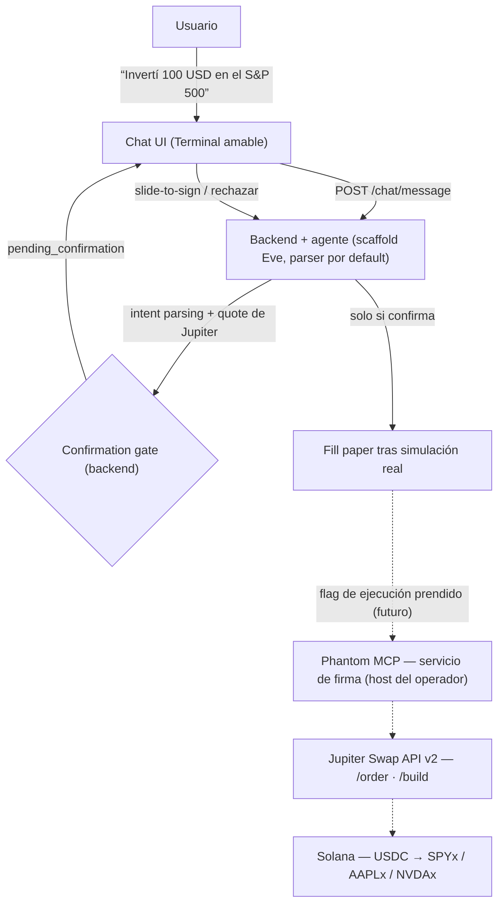

[English](README.md) | Español

# Onda — Tu agente inversor

Un agente inversor en lenguaje natural que compra acciones y ETFs tokenizados (xStocks) desde una wallet cripto detrás de un confirmation gate. Este repo es `agent-trading`; **Onda** es el nombre del producto.

**Versión del repo: 0.7.0** · **Preview en vivo:** https://onda.wonderfulsky-b50ff12c.eastus.azurecontainerapps.io/ · Demo interna — ejecución paper solamente.

## Preview en vivo

El producto está **live como “Onda — Tu agente inversor”** en https://onda.wonderfulsky-b50ff12c.eastus.azurecontainerapps.io/ (Azure Container Apps).

Qué funciona ahí hoy: registrarte e iniciar sesión, crear una paper wallet y cargarla, quotes reales de Jupiter en vivo, revisar la propuesta de swap y firmar compras paper con slide-to-sign, y ver portfolio, la ficha por activo (datos en vivo de Jupiter más IPO/inception, emisor y sector con fuente — también expuesta read-only a agentes vía la tool MCP `onda_get_asset_info`) e historial. El flujo agéntico se probó end-to-end sobre la URL pública: register → wallet → depósito → compra paper de SPYx → portfolio. El servidor MCP de Onda también está prendido en este preview como demo interna: en la app, abrí **Settings → Agentes externos (MCP)**, creá un token y apuntá cualquier cliente MCP a `https://onda.wonderfulsky-b50ff12c.eastus.azurecontainerapps.io/mcp` con `Authorization: Bearer <token>` (7 tools; la firma siempre ocurre en Onda, probado end-to-end con un cliente MCP real: quote → propose → pending → slide-to-sign físico → ejecutado paper).

También vive un mockup estático de diseño en https://agenttradingprev6cbfcf.z13.web.core.windows.net/ — es **solo un mockup de diseño**, no la app.

Lo que el preview en vivo deliberadamente **no** hace: la ejecución real está apagada (`EXECUTION_ENABLED=false`), la firma real sigue corriendo vía Phantom MCP — servicio de firma (host del operador), y el modo Eve/LLM está apagado sin keys de modelo (`AGENT_MODE=parser`).

## La idea

Un usuario escribe “Invertí 100 USD en el S&P 500” y el agente resuelve la intención (S&P 500 → SPYx), cotiza un swap USDC → xStock en Solana y le presenta la propuesta: “Estás comprando 100 USD de S&P 500 (SPYx). ¿Confirmás?”. Nada se firma ni se liquida hasta que el usuario confirma; rechazar o dejar vencer la propuesta no mueve un centavo.

La tesis es una sola y a propósito angosta: un LLM puede operar una wallet real de forma útil si el sistema — no el modelo — controla el dinero. Por eso el confirmation gate vive en el backend, es idempotente, tiene un único TTL visible y deja audit log. El agente propone; el backend dispone.

## Estado

Onda 0.6.0 es una demo interna live sobre infraestructura real, con ejecución paper:

- **UI Terminal amable** (la dirección de diseño aprobada): terminal oscura fría, confirmación como objeto de swap de Jupiter con slide-to-sign, layout con thread central, rail de portfolio y strip de precios en vivo. Reemplazó a la dirección anterior “editorial C” tras un teardown de productos comparables; C queda como antecedente histórico, no como dirección vigente.
- **Datos de mercado reales, fills simulados.** Las quotes, los precios, las verificaciones con `simulateTransaction` y los balances on-chain de la agent wallet son reales y en vivo. Los USDC y xStocks paper son filas de un ledger local, rotuladas `mode: "paper"` end-to-end y nunca presentadas como balances on-chain.
- **Confirmation gate** con estados `proposed → pending_confirmation → executing → executed/failed`, una confirmación pendiente por usuario, un único TTL `min(60s, quote 30s)` y audit log append-only con hash chain.
- **Deploy en Azure** en un solo container: Container Apps sirve web y API en el mismo origen (`SERVE_WEB=true`), con SQLite persistido en un share de Azure Files montado en `/data`. Ver [Deploy](#deploy).

## Quickstart

Prerrequisitos: **Node >= 24** (`engines` en `package.json`) y **pnpm 12.11.2** (pineado por el campo `packageManager`; activalo con `corepack enable` o instalá pnpm 12 directamente). Verificado en macOS; los mismos comandos aplican en Linux. Hace falta internet: las quotes, el chequeo de arranque del registry y las simulaciones de fills paper llaman a los endpoints en vivo de Jupiter y Solana RPC.

Desde un clone fresco, corré todo desde la raíz del repo:

```bash
corepack enable   # provee el pnpm 12.11.2 pineado (saltealo si ya tenés pnpm 12)
pnpm install      # los build scripts nativos de argon2/bufferutil/utf-8-validate están allow-listeados en pnpm-workspace.yaml
pnpm build        # compila apps/api (tsc) y apps/web (vite)
pnpm test         # tests deterministas de API y web
```

La API **no** carga `.env` automáticamente (no hay dependencia dotenv), así que exportá las variables en tu shell. Toda variable de [`.env.example`](.env.example) tiene un default de demo en `apps/api/src/config.ts`, pero siempre seteá un `SESSION_SECRET` real:

```bash
cp .env.example .env   # solo como referencia — editá los exports de tu shell, o sourcealo explícitamente
export SESSION_SECRET="$(openssl rand -hex 32)"
node apps/api/dist/index.js   # API en :3001 (terminal 1)
```

En una segunda terminal, levantá el cliente web apuntando a la API (sin `VITE_API_URL` el cliente llama al mismo origen, que solo funciona detrás del serving de producción con `SERVE_WEB=true`):

```bash
VITE_API_URL=http://localhost:3001 pnpm --filter web dev   # web en :5173 (terminal 2)
```

Después abrí http://localhost:5173, registrate, creá una paper wallet, cargá USDC paper y escribí `Invertí 10 USD en el S&P 500` en el chat. Revisá la tarjeta de confirmación y completá el gesto slide-to-sign: el fill se acredita como paper solo tras una simulación real en mainnet aprobada.

Notas que un usuario nuevo tiene que saber antes de la primera corrida:

- La API no arranca si un mint del token registry no verifica contra Jupiter (fail-closed). El tier keyless de Jupiter tiene rate-limit, así que una falla transitoria de verificación puede abortar un arranque — reintentá; no es un error de código.
- El arranque necesita un directorio `./data/` escribible (el `DATABASE_PATH=./data/app.sqlite` default); se crea en la primera corrida y está git-ignoreado.
- `SESSION_SECRET=<secreto-largo> node apps/api/dist/index.js` del quickstart viejo sigue funcionando, pero así ninguna otra variable de `.env.example` toma efecto. Para usar el archivo, exportá sus líneas no comentadas explícitamente, p. ej. `set -a; source .env; set +a` en bash/zsh.
- `pnpm e2e` corre `scripts/e2e-live.mjs` contra una API local corriendo en :3001 (levantala primero) y los endpoints en vivo de Jupiter/Solana.

Las URLs locales son para desarrollo; el preview en vivo de arriba es la forma más rápida de probar el producto.

### Consultar una wallet Solana (0.7.0)

En una página principal HTTPS o localhost con la extensión Phantom instalada, iniciá sesión en Onda, elegí la red de consulta en **Wallet Solana** y hacé clic en **Conectar Phantom**. Mainnet muestra SOL, USDC, SPYx, AAPLx y NVDAx; Devnet solo muestra SOL y USDC de prueba. El selector cambia la red que consulta Onda, no la configuración de la extensión. **Actualizar** vuelve a consultar. **Desconectar** borra la dirección y los saldos; recargar también limpia el panel y nunca reconecta automáticamente.

Onda envía la dirección pública a su API y al RPC de Solana configurado para consultar los saldos. No guarda la dirección en tu perfil de Onda ni la usa para iniciar sesión u operar. No pide firmas ni claves. Es una wallet existente inyectada por Phantom, no una embedded wallet ni un lanzamiento a producción. Ver [spec de wallet](docs/specs/01-wallet.md).

### Correr el MCP de Onda localmente

El servidor MCP sale detrás de `MCP_ENABLED` (apagado por default en el código; prendido en el preview en vivo como demo interna). Para probarlo local:

1. Levantá la API con el flag prendido y la base pública apuntando al cliente web (se usa para armar los deep links `signingUrl`):
   ```bash
   export SESSION_SECRET="$(openssl rand -hex 32)"
   export MCP_ENABLED=true
   export PUBLIC_BASE_URL=http://localhost:5173
   node apps/api/dist/index.js
   ```
   `GET /health` ahora debería reportar `"mcpEnabled":true`.
2. En la web, abrí **Settings → Agentes externos (MCP)**, creá un token (scopes `read:portfolio`, `quote`, `propose`) y copiá el secreto `onda_mcp_…` — se muestra una sola vez. La firma siempre ocurre en la sesión web de Onda; ninguna tool MCP puede confirmar ni ejecutar.
3. Apuntá cualquier cliente MCP a `http://localhost:3001/mcp` con el header bearer. Para Claude Code:
   ```bash
   claude mcp add --transport http onda http://localhost:3001/mcp \
     --header "Authorization: Bearer <tu-token-onda_mcp_>"
   claude mcp list
   ```
   Para Cursor, agregá una entrada en `~/.cursor/mcp.json`:
   ```json
   {
     "mcpServers": {
       "onda": {
         "url": "http://localhost:3001/mcp",
         "headers": { "Authorization": "Bearer ${env:ONDA_MCP_TOKEN}" }
       }
     }
   }
   ```
   Después pedile al cliente que liste las tools: deberías ver 7 tools (`onda_list_assets`, `onda_get_asset_info`, `onda_get_portfolio`, `onda_get_limits`, `onda_quote_swap`, `onda_propose_trade`, `onda_get_confirmation`). El detalle de diseño y el onboarding por cliente viven en [`docs/specs/07-onda-mcp.md`](docs/specs/07-onda-mcp.md).

## Arquitectura

Monorepo TypeScript (Node 24, workspaces de pnpm):

| Path | Qué es |
|---|---|
| `apps/api` | API Fastify + SQLite: auth, paper wallets/ledger, quotes de Jupiter, confirmation gate, portfolio, audit log |
| `apps/web` | Cliente Vite + TypeScript: UI Terminal amable |
| `agent/` | Scaffold del agente Eve 1.5.0 (instructions espejo + tools finas); el chat corre con el parser determinístico por default (`AGENT_MODE=parser`) |
| `deploy/` | `Dockerfile` y runbook de deploy en Azure |
| `docs/specs/` | El paquete completo de specs (en español; el idioma de trabajo del proyecto para docs de producto) |



Decisiones clave (detalle completo en [`docs/specs/`](docs/specs/README.md)):

1. El confirmation gate vive en el backend; el frontend solo lo presenta.
2. Jupiter Swap API v2 cotiza, arma y simula — y, cuando se prenda el flag, ejecuta. Phantom `buy` queda solo como comparación de quote, nunca como ejecutor, porque es opaco en slippage y no acepta un minimum-out explícito.
3. Phantom MCP cubre el path de demo single-agent (session local, una agent wallet, no multi-tenant); el path multi-usuario es Phantom Connect (fase 2, no implementado).
4. Los fills paper acreditan el `outAmount` de la quote solo tras una simulación real en mainnet aprobada, y quedan rotulados paper en todos lados.

## Deploy

Onda corre en Azure Container Apps en el resource group `rg-agent-trading-preview` (eastus):

- Un solo container desde [`deploy/Dockerfile`](deploy/Dockerfile): la API Fastify sirve el build web de Vite en el mismo origen cuando `SERVE_WEB=true`.
- SQLite persiste en un share de Azure Files en `DATABASE_PATH=/data/app.sqlite`.
- Flags de runtime: `EXECUTION_ENABLED=false`, `EXECUTION_MODE=paper`, `AGENT_MODE=parser`; `SESSION_SECRET` existe solo como secret de Container Apps, nunca en el repo.

El runbook completo — recursos, build y comandos de teardown, incluida la variante que borra solo la app y conserva el resource group del mockup estático — está en [`deploy/README.md`](deploy/README.md).

[Probá Onda en Kubernetes local con kind](deploy/k8s/README.md), con el mismo Dockerfile y datos sintéticos. Esto no cambia el preview de Container Apps ni valida AKS.

## Roadmap

- **Fase 1 — Demo interna live (hecha):** MVP v0.1.0 (PR #4), UI Terminal amable (PR #7), branding Onda + deploy en Azure (PR #8) → v0.2.0. Live en la URL de preview.
- **Fase 1.1 — Updates en vivo por SSE habilitados en el preview (v0.6.0):** `GET /api/v1/events` autenticado (cookie de sesión, heartbeat, aislamiento por usuario) emite ticks de cotización de Jupiter cada 12 s (sobre el cache de precios Jupiter de 60 s existente), cambios de estado de confirmations solo para su dueño y una señal de portfolio actualizado que hace que la UI refetchee el snapshot autoritativo; el cliente web reconecta con backoff y degrada al refresh manual de 30 s anterior cuando SSE cae. Sigue pendiente en 1.1: ejecución real detrás de `EXECUTION_ENABLED` pendiente de la decisión de fondeo del operador y del checklist KMS de la spec 01; opcionalmente, una proof de firma MCP en devnet iniciada desde la API.
- **Fase 1.2 — Onda MCP (en vivo en el preview de Azure como demo interna desde el 2026-11-27):** servidor MCP remoto (Streamable HTTP en `/mcp`, 7 tools, API tokens por usuario con vencimiento a 90 días) para operar desde el agente propio del usuario (ChatGPT/Claude/Cursor) con firma siempre en Onda; prendido en producción con `MCP_ENABLED=true` y probado end-to-end con un cliente MCP real (quote → propose → pending → slide-to-sign físico → ejecutado paper). Sigue siendo demo interna (H11 abierto) sobre la URL cruda de Azure: todavía sin dominio propio (Q-M3) y sin onboarding público; OAuth 2.1 es la fase 1.3. Corrida local: [Correr el MCP de Onda localmente](#correr-el-mcp-de-onda-localmente). Ver [`docs/specs/07-onda-mcp.md`](docs/specs/07-onda-mcp.md).
- **Fase 2 — Multi-usuario:** embedded wallets por usuario con Phantom Connect, spending limits por usuario (el gate sigue obligatorio).
- **Fase 3 — Ramp en pesos:** fondeo ARS → USDC con un ramp de terceros; el agente opera igual que hoy.

Vista de entrega: [`docs/roadmap.md`](docs/roadmap.md). Los riesgos y el registro de decisiones viven en [`docs/specs/06-roadmap-risks.md`](docs/specs/06-roadmap-risks.md).

## Decisiones y temas abiertos

Registradas el 2026-11-27 (detalle en la spec 06):

- **Q1 — Audiencia de la demo: interna.** La demo es solo interna; todavía no se muestra a terceros.
- **Q3 — Estado en vivo: SSE.** Implementado en v0.6.0 (fase 1.1): `GET /api/v1/events` con la sesión web; el MCP sigue con polling por diseño (Q-M4).
- **Q4 — Dónde corre el MCP: host del operador (host de desarrollo single-tenant hoy).** Host dedicado solo si la demo lo pide.
- **Q6 — Entrada por voz: no.** Fuera de alcance por ahora.
- **La ejecución sigue apagada:** `EXECUTION_ENABLED=false` hasta que el operador decida el fondeo.
- **H11 — ABIERTO (responsable: titular del proyecto):** la elegibilidad xStocks para un operador en Argentina sigue **sin verificar**. Hasta verificarla, la demo se queda interna. Es el único ítem de compliance abierto y bloquea mostrarla a terceros.

Límites honestos: ejecución paper solamente, MCP en vivo solo como demo interna sobre la URL cruda de Azure (sin dominio propio, sin directorios públicos, H11 todavía abierto), sin Phantom Connect, sin ramp en ARS, sin voz. Nada de esto es asesoramiento financiero.

## Docs

- [`docs/specs/README.md`](docs/specs/README.md) — índice de specs y visión de producto en una página
- [`docs/roadmap.md`](docs/roadmap.md) — vista de entrega
- [`docs/specs/06-roadmap-risks.md`](docs/specs/06-roadmap-risks.md) — fases, riesgos y decisiones
- [`deploy/README.md`](deploy/README.md) — runbook de deploy en Azure
- [`CHANGELOG.md`](CHANGELOG.md) — notas de release

> El alcance bilingüe de este repo es este README raíz. Las specs y los docs de producto bajo `docs/` se mantienen en español, el idioma de trabajo del proyecto; también el CHANGELOG.

## Contribuir

Ver [`CONTRIBUTING.md`](CONTRIBUTING.md) (en inglés). En corto: PRs chicos y revisables contra `main`; CI compila, corre los tests y renderiza el overlay kind sin desplegar. Todo PR actualiza VERSION y CHANGELOG, y ningún PR se mergea sin la palabra explícita del titular del proyecto. Specs primero para todo lo que toque dinero: el confirmation gate, el ledger y el comportamiento del flag de ejecución están especificados en `docs/specs/` y los cambios ahí se revisan antes de que siga el código.

## Licencia

Apache License 2.0 — ver [`LICENSE`](LICENSE).
