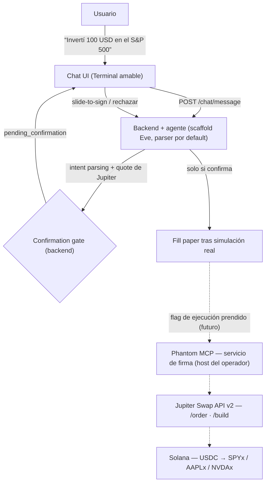

[English](README.md) | Español

# Onda — Tu agente inversor

Un agente inversor en lenguaje natural que compra acciones y ETFs tokenizados (xStocks) desde una wallet cripto detrás de un confirmation gate. Este repo es `agent-trading`; **Onda** es el nombre del producto.

**Versión 0.5.1** · **Preview en vivo:** https://onda.wonderfulsky-b50ff12c.eastus.azurecontainerapps.io/ · Demo interna — ejecución paper solamente.

## Preview en vivo

El producto está **live como “Onda — Tu agente inversor”** en https://onda.wonderfulsky-b50ff12c.eastus.azurecontainerapps.io/ (Azure Container Apps, resource group `rg-agent-trading-preview`, ~USD 20–30/mes).

Qué funciona ahí hoy: registrarte e iniciar sesión, crear una paper wallet y cargarla, quotes reales de Jupiter en vivo, revisar la propuesta de swap y firmar compras paper con slide-to-sign, y ver portfolio, la ficha por activo (datos en vivo de Jupiter más IPO/inception, emisor y sector con fuente — también expuesta read-only a agentes vía la tool MCP `onda_get_asset_info`) e historial. El flujo agéntico se probó end-to-end sobre la URL pública: register → wallet → depósito → compra paper de SPYx → portfolio.

También vive un mockup estático de diseño en https://agenttradingprev6cbfcf.z13.web.core.windows.net/ — es **solo un mockup de diseño**, no la app.

Lo que el preview en vivo deliberadamente **no** hace: la ejecución real está apagada (`EXECUTION_ENABLED=false`), la firma real sigue corriendo vía Phantom MCP — servicio de firma (host del operador), el modo Eve/LLM está apagado sin keys de modelo (`AGENT_MODE=parser`), y los updates en vivo por SSE están decididos pero todavía no implementados.

## La idea

Un usuario escribe “Invertí 100 USD en el S&P 500” y el agente resuelve la intención (S&P 500 → SPYx), cotiza un swap USDC → xStock en Solana y le presenta la propuesta: “Estás comprando 100 USD de S&P 500 (SPYx). ¿Confirmás?”. Nada se firma ni se liquida hasta que el usuario confirma; rechazar o dejar vencer la propuesta no mueve un centavo.

La tesis es una sola y a propósito angosta: un LLM puede operar una wallet real de forma útil si el sistema — no el modelo — controla el dinero. Por eso el confirmation gate vive en el backend, es idempotente, tiene un único TTL visible y deja audit log. El agente propone; el backend dispone.

## Estado

Onda 0.5.1 es una demo interna live sobre infraestructura real, con ejecución paper:

- **UI Terminal amable** (la dirección de diseño aprobada): terminal oscura fría, confirmación como objeto de swap de Jupiter con slide-to-sign, layout con thread central, rail de portfolio y strip de precios en vivo. Reemplazó a la dirección anterior “editorial C” tras un teardown de productos comparables; C queda como antecedente histórico, no como dirección vigente.
- **Datos de mercado reales, fills simulados.** Las quotes, los precios, las verificaciones con `simulateTransaction` y los balances on-chain de la agent wallet son reales y en vivo. Los USDC y xStocks paper son filas de un ledger local, rotuladas `mode: "paper"` end-to-end y nunca presentadas como balances on-chain.
- **Confirmation gate** con estados `proposed → pending_confirmation → executing → executed/failed`, una confirmación pendiente por usuario, un único TTL `min(60s, quote 30s)` y audit log append-only con hash chain.
- **Deploy en Azure** en un solo container: Container Apps sirve web y API en el mismo origen (`SERVE_WEB=true`), con SQLite persistido en un share de Azure Files montado en `/data`. Ver [Deploy](#deploy).

## Quickstart

Requiere Node 24 y pnpm 12 (ambos pineados en `package.json`).

```bash
pnpm install
cp .env.example .env   # SESSION_SECRET real; el resto tiene defaults de demo
pnpm --filter api build
pnpm test
SESSION_SECRET=<secreto-largo> node apps/api/dist/index.js   # API en :3001
pnpm --filter web dev                                        # web en :5173
```

Después abrí http://localhost:5173. La API no arranca si un mint del token registry no verifica contra Jupiter (fail-closed). `pnpm e2e` corre el script end-to-end contra APIs en vivo.

Las URLs locales son para desarrollo; el preview en vivo de arriba es la forma más rápida de probar el producto.

## Arquitectura

Monorepo TypeScript (Node 24, workspaces de pnpm):

| Path | Qué es |
|---|---|
| `apps/api` | API Fastify + SQLite: auth, paper wallets/ledger, quotes de Jupiter, confirmation gate, portfolio, audit log |
| `apps/web` | Cliente Vite + TypeScript: UI Terminal amable |
| `agent/` | Scaffold del agente Eve 1.5.0 (instructions espejo + tools finas); el chat corre con el parser determinístico por default (`AGENT_MODE=parser`) |
| `deploy/` | `Dockerfile` y runbook de deploy en Azure |
| `docs/specs/` | El paquete completo de specs (en español; el idioma de trabajo del proyecto para docs de producto) |



Decisiones clave (detalle completo en [`docs/specs/`](docs/specs/README.md)):

1. El confirmation gate vive en el backend; el frontend solo lo presenta.
2. Jupiter Swap API v2 cotiza, arma y simula — y, cuando se prenda el flag, ejecuta. Phantom `buy` queda solo como comparación de quote, nunca como ejecutor, porque es opaco en slippage y no acepta un minimum-out explícito.
3. Phantom MCP cubre el path de demo single-agent (session local, una agent wallet, no multi-tenant); el path multi-usuario es Phantom Connect (fase 2, no implementado).
4. Los fills paper acreditan el `outAmount` de la quote solo tras una simulación real en mainnet aprobada, y quedan rotulados paper en todos lados.

## Deploy

Onda corre en Azure Container Apps en el resource group `rg-agent-trading-preview` (eastus):

- Un solo container desde [`deploy/Dockerfile`](deploy/Dockerfile): la API Fastify sirve el build web de Vite en el mismo origen cuando `SERVE_WEB=true`.
- SQLite persiste en un share de Azure Files en `DATABASE_PATH=/data/app.sqlite`.
- Flags de runtime: `EXECUTION_ENABLED=false`, `EXECUTION_MODE=paper`, `AGENT_MODE=parser`; `SESSION_SECRET` existe solo como secret de Container Apps, nunca en el repo.
- Costo estimado: ~**USD 20–30/mes** (Container Apps + ACR Basic + Azure Files + Log Analytics).

El runbook completo — recursos, build y comandos de teardown, incluida la variante que borra solo la app y conserva el resource group del mockup estático — está en [`deploy/README.md`](deploy/README.md).

## Roadmap

- **Fase 1 — Demo interna live (hecha):** MVP v0.1.0 (PR #4), UI Terminal amable (PR #7), branding Onda + deploy en Azure (PR #8) → v0.2.0. Live en la URL de preview.
- **Fase 1.1 — Siguiente:** updates en vivo por SSE (decidido: SSE sobre polling); ejecución real detrás de `EXECUTION_ENABLED` pendiente de la decisión de fondeo del operador y del checklist KMS de la spec 01; opcionalmente, una proof de firma MCP en devnet iniciada desde la API.
- **Fase 1.2 — Onda MCP (código enviado detrás de flag, no prendido en Azure):** servidor MCP remoto (Streamable HTTP en `/mcp`, 6 tools, API tokens por usuario con vencimiento a 90 días) para operar desde el agente propio del usuario (ChatGPT/Claude/Cursor) con firma siempre en Onda; queda apagado hasta `MCP_ENABLED=true` y dominio propio. Ver [`docs/specs/07-onda-mcp.md`](docs/specs/07-onda-mcp.md).
- **Fase 2 — Multi-usuario:** embedded wallets por usuario con Phantom Connect, spending limits por usuario (el gate sigue obligatorio).
- **Fase 3 — Ramp en pesos:** fondeo ARS → USDC con un ramp de terceros; el agente opera igual que hoy.

Vista de entrega: [`docs/roadmap.md`](docs/roadmap.md). Los riesgos y el registro de decisiones viven en [`docs/specs/06-roadmap-risks.md`](docs/specs/06-roadmap-risks.md).

## Decisiones y temas abiertos

Registradas el 2026-11-27 (detalle en la spec 06):

- **Q1 — Audiencia de la demo: interna.** La demo es solo interna; todavía no se muestra a terceros.
- **Q3 — Estado en vivo: SSE.** Se eligió SSE sobre polling; todavía no implementado (fase 1.1).
- **Q4 — Dónde corre el MCP: host del operador (host de desarrollo single-tenant hoy).** Host dedicado solo si la demo lo pide.
- **Q6 — Entrada por voz: no.** Fuera de alcance por ahora.
- **La ejecución sigue apagada:** `EXECUTION_ENABLED=false` hasta que el operador decida el fondeo.
- **H11 — ABIERTO (responsable: titular del proyecto):** la elegibilidad xStocks para un operador en Argentina sigue **sin verificar**. Hasta verificarla, la demo se queda interna. Es el único ítem de compliance abierto y bloquea mostrarla a terceros.

Límites honestos: ejecución paper solamente, código MCP enviado detrás de flag pero todavía no prendido en la preview de Azure, sin Phantom Connect, sin ramp en ARS, sin SSE todavía, sin voz. Nada de esto es asesoramiento financiero.

## Docs

- [`docs/specs/README.md`](docs/specs/README.md) — índice de specs y visión de producto en una página
- [`docs/roadmap.md`](docs/roadmap.md) — vista de entrega
- [`docs/specs/06-roadmap-risks.md`](docs/specs/06-roadmap-risks.md) — fases, riesgos y decisiones
- [`deploy/README.md`](deploy/README.md) — runbook de deploy en Azure
- [`CHANGELOG.md`](CHANGELOG.md) — notas de release

> El alcance bilingüe de este repo es este README raíz. Las specs y los docs de producto bajo `docs/` se mantienen en español, el idioma de trabajo del proyecto; también el CHANGELOG.

## Contribuir

PRs chicos y revisables contra `main`; todo PR necesita `pnpm build` y `pnpm test` en verde, y ningún PR se mergea sin la palabra explícita del titular del proyecto. Specs primero para todo lo que toque dinero: el confirmation gate, el ledger y el comportamiento del flag de ejecución están especificados en `docs/specs/` y los cambios ahí se revisan antes de que siga el código.

## Licencia

Apache License 2.0 — ver [`LICENSE`](LICENSE).
