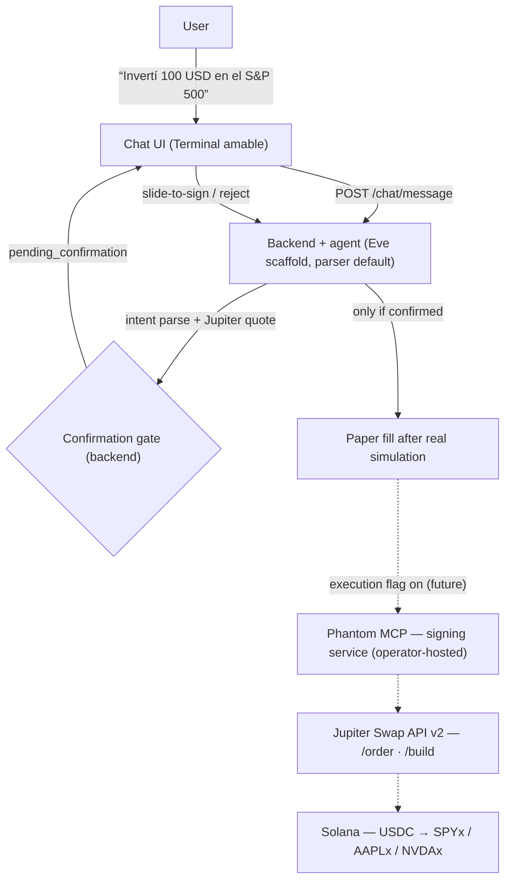

English | [Español](README.es.md)

# Onda — Your investing agent

A natural-language investing agent that buys tokenized stocks and ETFs (xStocks) from a crypto wallet behind a confirmation gate. This repository is `agent-trading`; **Onda** is the product name.

**Repository version: 0.7.0** · **Live preview:** https://onda.wonderfulsky-b50ff12c.eastus.azurecontainerapps.io/ · Internal demo — paper execution only.

## Live preview

The product is **live as “Onda — Tu agente inversor”** at https://onda.wonderfulsky-b50ff12c.eastus.azurecontainerapps.io/ (Azure Container Apps).

What works there today: register and sign in, create a paper wallet and fund it, get live Jupiter quotes, review a swap proposal and sign paper buys with a slide-to-sign gesture, and see portfolio, per-asset detail sheets (live Jupiter data plus sourced IPO/inception, issuer, sector info — also exposed read-only to agents via the MCP tool `onda_get_asset_info`), and transaction history. The agentic flow was proven end-to-end on the public URL: register → wallet → deposit → buy SPYx (paper) → portfolio. The Onda MCP server is also enabled on this preview as an internal demo: in the app, open **Settings → Agentes externos (MCP)**, create a token, and point any MCP client at `https://onda.wonderfulsky-b50ff12c.eastus.azurecontainerapps.io/mcp` with `Authorization: Bearer <token>` (7 tools; signing always in Onda, proven end-to-end with a real MCP client: quote → propose → pending → physical slide-to-sign → executed paper).

A static design mockup is also live at https://agenttradingprev6cbfcf.z13.web.core.windows.net/ — that is a **design mockup only**, not the app.

What the live preview deliberately does **not** do: real execution is off (`EXECUTION_ENABLED=false`), signed transactions still run through the Phantom MCP signing service (operator-hosted), and the Eve/LLM chat mode is off without model keys (`AGENT_MODE=parser`).

## The idea

A user types “Invertí 100 USD en el S&P 500” and the agent resolves the intent (S&P 500 → SPYx), quotes a USDC → xStock swap on Solana, and presents the proposal: “You're buying 100 USD of S&P 500 (SPYx). Confirm?” Nothing signs or settles until the user confirms; rejecting or letting the proposal expire moves no money.

The thesis is narrow on purpose: an LLM can operate a real wallet usefully if the system — not the model — controls the money. The confirmation gate lives in the backend, is idempotent, has a single visible TTL, and writes an audit log. The agent proposes; the backend disposes.

## Status

Onda 0.6.0 is a live internal demo on real infrastructure, running paper execution:

- **Terminal amable UI** (the approved design direction): a cold dark terminal, Jupiter swap-object confirmation with slide-to-sign, a thread-centered layout, a portfolio rail and a live prices strip. This replaced the earlier “editorial C” direction after a teardown of comparable products; C is historical, not current.
- **Real market data, simulated fills.** Quotes, prices, `simulateTransaction` checks and the agent wallet's on-chain balances are real and live. Paper USDC and paper xStocks are local ledger rows, labeled `mode: "paper"` end-to-end and never presented as on-chain balances.
- **Confirmation gate** with states `proposed → pending_confirmation → executing → executed/failed`, one pending confirmation per user, a single TTL of `min(60s, quote 30s)`, and an append-only audit log with a hash chain.
- **Azure deploy** in a single container: Container Apps serves web and API on the same origin (`SERVE_WEB=true`), with SQLite persisted on an Azure Files share mounted at `/data`. See [Deploy](#deploy).

## Quickstart

Prerequisites: **Node >= 24** (`engines` in `package.json`) and **pnpm 12.11.2** (pinned by the `packageManager` field; enable it with `corepack enable` or install pnpm 12 directly). Verified on macOS; the same commands apply on Linux. Internet access is required: quotes, the registry boot check and paper-fill simulations call the live Jupiter and Solana RPC endpoints.

From a fresh clone, run everything from the repository root:

```bash
corepack enable   # provides the pinned pnpm 12.11.2 (skip if pnpm 12 is already installed)
pnpm install      # native build scripts for argon2/bufferutil/utf-8-validate are allow-listed in pnpm-workspace.yaml
pnpm build        # builds apps/api (tsc) and apps/web (vite)
pnpm test         # deterministic API and web tests
```

The API does **not** auto-load `.env` (there is no dotenv dependency), so export the variables in your shell. Every variable in [`.env.example`](.env.example) has a demo default in `apps/api/src/config.ts` except that you should always set a real `SESSION_SECRET`:

```bash
cp .env.example .env   # reference only — edit your shell exports below, or source it explicitly
export SESSION_SECRET="$(openssl rand -hex 32)"
node apps/api/dist/index.js   # API on :3001 (terminal 1)
```

In a second terminal, start the web client pointed at the API (without `VITE_API_URL` the client calls the same origin, which only works behind the `SERVE_WEB=true` production serving):

```bash
VITE_API_URL=http://localhost:3001 pnpm --filter web dev   # web on :5173 (terminal 2)
```

Then open http://localhost:5173, register, create a paper wallet, deposit paper USDC, and type `Invertí 10 USD en el S&P 500` in the chat. Review the confirmation card and complete the slide-to-sign gesture: the fill is credited as paper only after a real mainnet simulation succeeds.

Notes a new user should know before the first run:

- The API refuses to boot if a token-registry mint does not verify against Jupiter (fail-closed). Jupiter's keyless tier is rate-limited, so a transient verification failure can abort a boot — just retry; it is not a code error.
- Boot needs a writable `./data/` directory (the default `DATABASE_PATH=./data/app.sqlite`); it is created on first run and is git-ignored.
- `SESSION_SECRET=<long-secret> node apps/api/dist/index.js` from the old quickstart still works, but then no other `.env.example` variable takes effect. To use the file, export its non-comment lines explicitly, e.g. `set -a; source .env; set +a` in bash/zsh.
- `pnpm e2e` runs `scripts/e2e-live.mjs` against a locally running API on :3001 (start it first) and live Jupiter/Solana endpoints.

Note that the local URLs are for development. The live preview above is the fastest way to try the product.

### View a Solana wallet (0.7.0)

On a top-level HTTPS or localhost page with the Phantom browser extension installed, sign in to Onda, choose a balance network under **Solana wallet**, and click **Connect Phantom**. Mainnet shows SOL, USDC, SPYx, AAPLx and NVDAx; Devnet shows test SOL and USDC only. The selector changes the network Onda queries, not the extension’s settings. **Refresh** reads a new snapshot. **Disconnect** clears the address and balances; reload also clears the panel and never reconnects automatically.

Onda sends the public address to its API and the configured Solana RPC to look up balances. It does not save the address to your Onda profile, use it as login or trade with it. The app does not request signatures or keys. This is an injected, existing wallet, not an embedded wallet or a production rollout. See the [wallet spec](docs/specs/01-wallet.md).

### Run the Onda MCP locally

The MCP server ships behind `MCP_ENABLED` (default off in code; enabled on the live preview as an internal demo). To try it locally:

1. Start the API with the flag on and the public base URL pointing at the web client (used to build `signingUrl` deep links):
   ```bash
   export SESSION_SECRET="$(openssl rand -hex 32)"
   export MCP_ENABLED=true
   export PUBLIC_BASE_URL=http://localhost:5173
   node apps/api/dist/index.js
   ```
   `GET /health` should now report `"mcpEnabled":true`.
2. In the web app, open **Settings → Agentes externos (MCP)**, create a token (scopes `read:portfolio`, `quote`, `propose`) and copy the `onda_mcp_…` secret — it is shown only once. Signing always happens in the Onda web session; no MCP tool can confirm or execute.
3. Point any MCP client at `http://localhost:3001/mcp` with the bearer header. For Claude Code:
   ```bash
   claude mcp add --transport http onda http://localhost:3001/mcp \
     --header "Authorization: Bearer <your-onda_mcp_-token>"
   claude mcp list
   ```
   For Cursor, add a server entry in `~/.cursor/mcp.json`:
   ```json
   {
     "mcpServers": {
       "onda": {
         "url": "http://localhost:3001/mcp",
         "headers": { "Authorization": "Bearer ${env:ONDA_MCP_TOKEN}" }
       }
     }
   }
   ```
   Then ask the client to list tools: you should see 7 tools (`onda_list_assets`, `onda_get_asset_info`, `onda_get_portfolio`, `onda_get_limits`, `onda_quote_swap`, `onda_propose_trade`, `onda_get_confirmation`). Design detail and per-client onboarding live in [`docs/specs/07-onda-mcp.md`](docs/specs/07-onda-mcp.md).

## Architecture

TypeScript monorepo (Node 24, pnpm workspaces):

| Path | What it is |
|---|---|
| `apps/api` | Fastify API + SQLite: auth, paper wallets/ledger, Jupiter quotes, confirmation gate, portfolio, audit log |
| `apps/web` | Vite + TypeScript client: Terminal amable UI |
| `agent/` | Eve 1.5.0 agent scaffold (instructions mirror + thin tools); chat runs on the deterministic parser by default (`AGENT_MODE=parser`) |
| `deploy/` | `Dockerfile` and Azure deploy runbook |
| `docs/specs/` | The full spec package (in Spanish; the repo's working language for product docs) |



Key decisions (full detail in [`docs/specs/`](docs/specs/README.md)):

1. The confirmation gate lives in the backend; the frontend only presents it.
2. Jupiter Swap API v2 quotes, builds and simulates — and, once the flag flips, executes. Phantom `buy` is quote-comparison only, never the executor, because it is opaque about slippage and takes no explicit minimum-out.
3. Phantom MCP covers the single-agent demo path (local session, one agent wallet, not multi-tenant); the multi-user path is Phantom Connect (phase 2, not implemented).
4. Paper fills credit the quote's `outAmount` only after a successful real mainnet simulation, and are labeled paper everywhere.

## Deploy

Onda runs on Azure Container Apps in resource group `rg-agent-trading-preview` (eastus):

- One container from [`deploy/Dockerfile`](deploy/Dockerfile): the Fastify API serves the Vite web build same-origin when `SERVE_WEB=true`.
- SQLite persists on an Azure Files share at `DATABASE_PATH=/data/app.sqlite`.
- Runtime flags: `EXECUTION_ENABLED=false`, `EXECUTION_MODE=paper`, `AGENT_MODE=parser`; `SESSION_SECRET` exists only as a Container Apps secret, never in the repo.

The full runbook — resources, build, and teardown commands, including the variant that deletes only the app and preserves the static mockup's resource group — is in [`deploy/README.md`](deploy/README.md).

[Run Onda on local Kubernetes with kind](deploy/k8s/README.md) using the same Dockerfile and synthetic data. This does not change the Container Apps preview or validate AKS.

## Roadmap

- **Phase 1 — Live internal demo (done):** v0.1.0 MVP (PR #4), Terminal amable UI (PR #7), Onda branding + Azure deploy (PR #8) → v0.2.0. Live at the preview URL.
- **Phase 1.1 — SSE live updates enabled on the preview (v0.6.0):** authenticated `GET /api/v1/events` (session cookie, heartbeat, per-user isolation) streams Jupiter quote ticks every 12s (backed by the existing 60s Jupiter price cache), confirmation state changes for the owner only, and a portfolio-changed signal that makes the UI refetch the authoritative snapshot; the web client reconnects with backoff and degrades to the previous 30s manual refresh when SSE is down. Still pending in 1.1: real execution behind `EXECUTION_ENABLED` pending the operator's funding decision and the spec-01 KMS checklist; optionally, a `devnet` MCP signing proof initiated from the API.
- **Phase 1.2 — Onda MCP (live on the Azure preview as an internal demo since 2026-11-27):** remote MCP server (Streamable HTTP at `/mcp`, 7 tools, per-user API tokens with 90-day expiry) so users can operate from their own agent (ChatGPT/Claude/Cursor) with signing always in Onda; enabled in production with `MCP_ENABLED=true` and proven end-to-end with a real MCP client (quote → propose → pending → physical slide-to-sign → executed paper). Still an internal demo (H11 open) on the raw Azure URL: no custom domain yet (Q-M3) and no public onboarding; OAuth 2.1 is phase 1.3. Local run: [Run the Onda MCP locally](#run-the-onda-mcp-locally). See [`docs/specs/07-onda-mcp.md`](docs/specs/07-onda-mcp.md).
- **Phase 2 — Multi-user:** Phantom Connect embedded wallets per user, per-user spending limits (the gate stays mandatory).
- **Phase 3 — ARS on-ramp:** ARS → USDC funding via a third-party ramp; the agent operates unchanged on top.

Delivery view: [`docs/roadmap.md`](docs/roadmap.md). Risks and the decision log live in [`docs/specs/06-roadmap-risks.md`](docs/specs/06-roadmap-risks.md).

## Decisions and open items

Recorded 2026-11-27 (detail in spec 06):

- **Q1 — Demo audience: internal.** The demo is internal-only; no external showing yet.
- **Q3 — Live updates: SSE.** Implemented in v0.6.0 (phase 1.1): `GET /api/v1/events` with the web session; MCP keeps polling by design (Q-M4).
- **Q4 — MCP host: operator host (single-tenant dev host today).** A dedicated host only if the demo needs it.
- **Q6 — Voice input: no.** Out of scope for now.
- **Execution stays off:** `EXECUTION_ENABLED=false` until the operator decides on funding.
- **H11 — OPEN (owner: project owner):** xStocks eligibility for an operator in Argentina is still **unverified**. Until verified, the demo stays internal-only. This is the one open compliance item and it gates any third-party showing.

Honest limits: paper execution only, MCP live only as an internal demo on the raw Azure URL (no custom domain, no public directories, H11 still open), no Phantom Connect, no ARS on-ramp, no voice. Nothing here is financial advice.

## Docs

- [`docs/specs/README.md`](docs/specs/README.md) — spec index and one-page product vision (Spanish)
- [`docs/roadmap.md`](docs/roadmap.md) — delivery view (Spanish)
- [`docs/specs/06-roadmap-risks.md`](docs/specs/06-roadmap-risks.md) — phases, risks, decisions (Spanish)
- [`deploy/README.md`](deploy/README.md) — Azure deploy runbook
- [`CHANGELOG.md`](CHANGELOG.md) — release notes (Spanish)

> The bilingual scope of this repo is this root README. Product specs and docs under `docs/` stay in Spanish, the project's working language; so does the CHANGELOG.

## Contributing

See [`CONTRIBUTING.md`](CONTRIBUTING.md). In short: small, reviewable PRs against `main`; CI builds, runs tests and renders the kind overlay without deploying. Every PR carries its VERSION + CHANGELOG paper trail, and no PR merges without the project owner's explicit word. Specs first for anything money-adjacent: the confirmation gate, ledger and execution-flag behavior are specified in `docs/specs/` and changes there are reviewed before code follows.

## License

Apache License 2.0 — see [`LICENSE`](LICENSE).
