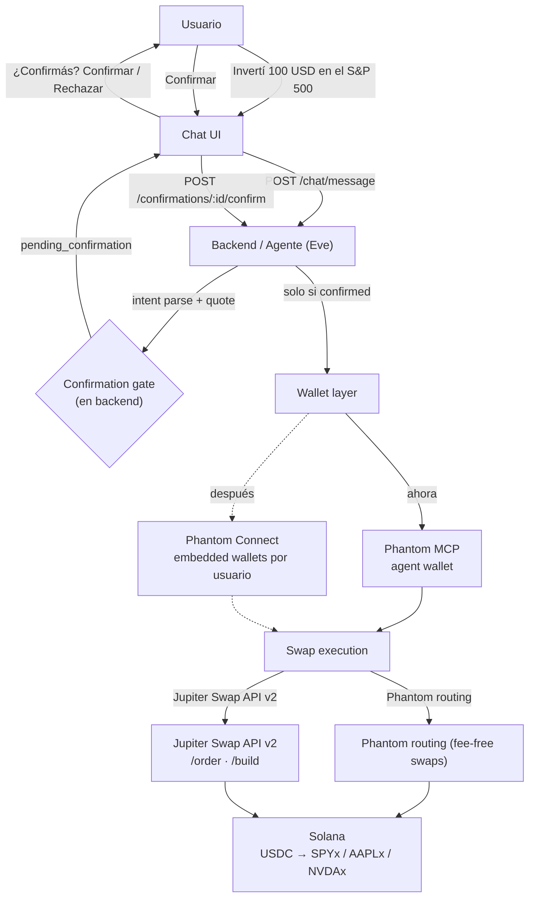

# agent-trading

Agente de IA que invierte en acciones y ETFs tokenizados (xStocks) desde una wallet cripto a través de lenguaje natural, con un confirmation gate antes de cualquier ejecución.

> **Estado actual: fase de specs (fase 0 validada; todavía no hay código de producto)**

## Qué es

Un usuario escribe "Invertí 100 USD en el S&P 500" y el agente interpreta la intención, resuelve el activo (S&P 500 → SPYx), cotiza el swap USDC → xStock y le muestra la propuesta: "Estás comprando 100 USD de S&P 500 (SPYx). ¿Confirmás?". Recién con **Confirmar** se firma y se envía la transacción on-chain en Solana. Rechazar o dejar vencer la propuesta no mueve un centavo.

La tesis que prueba la demo es una sola: un LLM puede operar una wallet real de forma útil si el sistema — no el modelo — controla el dinero. Por eso el confirmation gate vive en el backend, es idempotente, tiene TTL y deja audit log; el agente propone, el backend dispone.

## Estado: sin código todavía

Este repositorio **todavía no contiene código ejecutable**: no hay nada para instalar, compilar ni correr, y por eso no hay instrucciones de instalación ni de uso. Hoy el repo contiene únicamente el paquete de specs en [`docs/specs/`](docs/specs/).

Lo que sigue es la fase 1 (ver [Roadmap](#roadmap)). Cuando exista código, este README va a sumar las instrucciones reales para levantarlo; hasta entonces, cualquier comando de quickstart sería inventado.

### Qué existe hoy

Ya validado en la fase 0, sin código de producto y sin fondeo en mainnet:

- **Phantom MCP como agent wallet:** wallet dedicada de `@phantom/mcp-server`, con sign-in por device-code y firma end-to-end probada en devnet (preview con `chainId` = `solana:103`, `confirmed: true` y transacción finalized).
- **Quotes reales de Jupiter en mainnet:** quotes de Jupiter Swap API v2 para SPYx, AAPLx y NVDAx con `taker` = agent wallet, con armado de transacción y simulación, con saldo cero.
- **Specs completas** en [`docs/specs/`](docs/specs/): el diseño de punta a punta, listo para implementar en la fase 1.

## Arquitectura

En una frase: chat UI → backend/agente (Eve) → confirmation gate → wallet layer (Phantom MCP ahora, Phantom Connect después) → Jupiter Swap API v2 / Phantom routing → Solana.

Decisiones ya tomadas (detalle en [`docs/specs/README.md`](docs/specs/README.md)):

1. **Gate dentro del backend**, presentado por el frontend.
2. **Phantom MCP para la demo, Phantom Connect para escalar.** El MCP corre con session local y una sola agent wallet; no es multi-tenant.
3. **Phantom `buy` como ejecutor primario de la demo; Jupiter Swap API v2 como path de control/fallback** con quote propio y firma explícita. Como `buy` es opaco en slippage, la propuesta del gate muestra la quote de Jupiter con su minimum-out.
4. **Eve (vercel/eve) como agent framework**, estructura filesystem-first.

## Roadmap

- **Fase 0 — Validación manual (sin código de producto). Cumplida:** agent wallet de Phantom MCP obtenida, quotes reales de Jupiter en mainnet con saldo cero y firma probada end-to-end en devnet.
- **Fase 1 — Demo single-wallet, modo Track A:** backend + agente Eve + chat UI + confirmation gate; quotes y simulación reales en mainnet, portfolio desde balances on-chain, paper fill solo tras simulación aprobada y ejecución real detrás de un config flag apagado por defecto.
- **Fase 2 — Multi-usuario:** registro con Phantom Connect, una embedded wallet por usuario, spending limits por usuario y portfolio e historial por usuario (el gate sigue obligatorio).
- **Fase 3 — Ramp en pesos:** fondeo en ARS con un ramp de terceros que convierte ARS → USDC directo a la wallet del usuario; el agente opera igual que hoy.

Detalle completo, criterios de salida y preguntas abiertas en [`docs/specs/06-roadmap-risks.md`](docs/specs/06-roadmap-risks.md).

## Specs

Índice del paquete completo:

| Doc | Contenido |
|---|---|
| [`docs/specs/README.md`](docs/specs/README.md) | Visión en una página, índice, alcance y decisiones ya tomadas |
| [`docs/specs/00-overview.md`](docs/specs/00-overview.md) | Problema, usuarios, objetivo de la demo, non-goals y supuestos |
| [`docs/specs/01-wallet.md`](docs/specs/01-wallet.md) | Modelo de wallet: Phantom MCP (demo) vs Phantom Connect (multi-usuario), custodia |
| [`docs/specs/02-swaps-xstocks.md`](docs/specs/02-swaps-xstocks.md) | Ejecución de swaps: Phantom `buy` vs Jupiter Swap API v2, token registry, slippage |
| [`docs/specs/03-agent-flows.md`](docs/specs/03-agent-flows.md) | Comportamiento del agente (Eve): intent parsing, alias map, contrato de tools |
| [`docs/specs/04-confirmation-gate.md`](docs/specs/04-confirmation-gate.md) | El gate de validación: estados, TTL, idempotency, copy UX, audit log |
| [`docs/specs/05-backend-api.md`](docs/specs/05-backend-api.md) | Contrato HTTP, modelo de datos y auth |
| [`docs/specs/06-roadmap-risks.md`](docs/specs/06-roadmap-risks.md) | Fases 0–3, riesgos y preguntas abiertas |

## Riesgos y compliance

- **Restricciones geográficas de xStocks (tema abierto):** xStocks no está disponible en algunas jurisdicciones y el issuer puede exigir KYC. Es un riesgo abierto, no resuelto por las specs: hay que verificar los términos del issuer y la jurisdicción del operador antes de mostrar la demo a terceros. Si un swap es rechazado por compliance, el agente debe responder con el motivo, no con un error genérico.
- **La demo no ejecuta nada en mainnet sin fondos:** la validación de la fase 0 usó quotes y simulaciones en mainnet con saldo cero, y firma real solo en devnet con fondos de faucet. La ejecución real queda detrás de un config flag apagado por defecto en la fase 1.
- **Nada de esto es asesoramiento financiero.** El agente ejecuta intenciones del usuario; no recomienda qué comprar. Este repositorio documenta un diseño de software, no una recomendación de inversión.

## License

MIT — ver [`LICENSE`](LICENSE).
