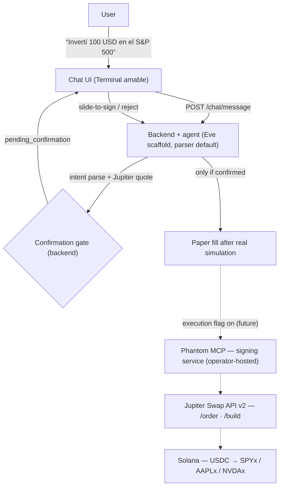

English | [Español](README.es.md)

# Onda — Your investing agent

A natural-language investing agent that buys tokenized stocks and ETFs (xStocks) from a crypto wallet behind a confirmation gate. This repository is `agent-trading`; **Onda** is the product name.

**Version 0.5.1** · **Live preview:** https://onda.wonderfulsky-b50ff12c.eastus.azurecontainerapps.io/ · Internal demo — paper execution only.

## Live preview

The product is **live as “Onda — Tu agente inversor”** at https://onda.wonderfulsky-b50ff12c.eastus.azurecontainerapps.io/ (Azure Container Apps, resource group `rg-agent-trading-preview`, roughly USD 20–30/month).

What works there today: register and sign in, create a paper wallet and fund it, get live Jupiter quotes, review a swap proposal and sign paper buys with a slide-to-sign gesture, and see portfolio, per-asset detail sheets (live Jupiter data plus sourced IPO/inception, issuer, sector info — also exposed read-only to agents via the MCP tool `onda_get_asset_info`), and transaction history. The agentic flow was proven end-to-end on the public URL: register → wallet → deposit → buy SPYx (paper) → portfolio.

A static design mockup is also live at https://agenttradingprev6cbfcf.z13.web.core.windows.net/ — that is a **design mockup only**, not the app.

What the live preview deliberately does **not** do: real execution is off (`EXECUTION_ENABLED=false`), signed transactions still run through the Phantom MCP signing service (operator-hosted), the Eve/LLM chat mode is off without model keys (`AGENT_MODE=parser`), and SSE live updates are decided but not yet implemented.

## The idea

A user types “Invertí 100 USD en el S&P 500” and the agent resolves the intent (S&P 500 → SPYx), quotes a USDC → xStock swap on Solana, and presents the proposal: “You're buying 100 USD of S&P 500 (SPYx). Confirm?” Nothing signs or settles until the user confirms; rejecting or letting the proposal expire moves no money.

The thesis is narrow on purpose: an LLM can operate a real wallet usefully if the system — not the model — controls the money. The confirmation gate lives in the backend, is idempotent, has a single visible TTL, and writes an audit log. The agent proposes; the backend disposes.

## Status

Onda 0.5.1 is a live internal demo on real infrastructure, running paper execution:

- **Terminal amable UI** (the approved design direction): a cold dark terminal, Jupiter swap-object confirmation with slide-to-sign, a thread-centered layout, a portfolio rail and a live prices strip. This replaced the earlier “editorial C” direction after a teardown of comparable products; C is historical, not current.
- **Real market data, simulated fills.** Quotes, prices, `simulateTransaction` checks and the agent wallet's on-chain balances are real and live. Paper USDC and paper xStocks are local ledger rows, labeled `mode: "paper"` end-to-end and never presented as on-chain balances.
- **Confirmation gate** with states `proposed → pending_confirmation → executing → executed/failed`, one pending confirmation per user, a single TTL of `min(60s, quote 30s)`, and an append-only audit log with a hash chain.
- **Azure deploy** in a single container: Container Apps serves web and API on the same origin (`SERVE_WEB=true`), with SQLite persisted on an Azure Files share mounted at `/data`. See [Deploy](#deploy).

## Quickstart

Requires Node 24 and pnpm 12 (both pinned in `package.json`).

```bash
pnpm install
cp .env.example .env   # set a real SESSION_SECRET; the rest have demo defaults
pnpm --filter api build
pnpm test
SESSION_SECRET=<long-secret> node apps/api/dist/index.js   # API on :3001
pnpm --filter web dev                                      # web on :5173
```

Then open http://localhost:5173. The API refuses to boot if a token-registry mint does not verify against Jupiter (fail-closed). `pnpm e2e` runs the end-to-end script against live APIs.

Note that the local URLs are for development. The live preview above is the fastest way to try the product.

## Architecture

TypeScript monorepo (Node 24, pnpm workspaces):

| Path | What it is |
|---|---|
| `apps/api` | Fastify API + SQLite: auth, paper wallets/ledger, Jupiter quotes, confirmation gate, portfolio, audit log |
| `apps/web` | Vite + TypeScript client: Terminal amable UI |
| `agent/` | Eve 1.5.0 agent scaffold (instructions mirror + thin tools); chat runs on the deterministic parser by default (`AGENT_MODE=parser`) |
| `deploy/` | `Dockerfile` and Azure deploy runbook |
| `docs/specs/` | The full spec package (in Spanish; the repo's working language for product docs) |



Key decisions (full detail in [`docs/specs/`](docs/specs/README.md)):

1. The confirmation gate lives in the backend; the frontend only presents it.
2. Jupiter Swap API v2 quotes, builds and simulates — and, once the flag flips, executes. Phantom `buy` is quote-comparison only, never the executor, because it is opaque about slippage and takes no explicit minimum-out.
3. Phantom MCP covers the single-agent demo path (local session, one agent wallet, not multi-tenant); the multi-user path is Phantom Connect (phase 2, not implemented).
4. Paper fills credit the quote's `outAmount` only after a successful real mainnet simulation, and are labeled paper everywhere.

## Deploy

Onda runs on Azure Container Apps in resource group `rg-agent-trading-preview` (eastus):

- One container from [`deploy/Dockerfile`](deploy/Dockerfile): the Fastify API serves the Vite web build same-origin when `SERVE_WEB=true`.
- SQLite persists on an Azure Files share at `DATABASE_PATH=/data/app.sqlite`.
- Runtime flags: `EXECUTION_ENABLED=false`, `EXECUTION_MODE=paper`, `AGENT_MODE=parser`; `SESSION_SECRET` exists only as a Container Apps secret, never in the repo.
- Estimated cost: roughly **USD 20–30/month** (Container Apps + ACR Basic + Azure Files + Log Analytics).

The full runbook — resources, build, and teardown commands, including the variant that deletes only the app and preserves the static mockup's resource group — is in [`deploy/README.md`](deploy/README.md).

## Roadmap

- **Phase 1 — Live internal demo (done):** v0.1.0 MVP (PR #4), Terminal amable UI (PR #7), Onda branding + Azure deploy (PR #8) → v0.2.0. Live at the preview URL.
- **Phase 1.1 — Next:** SSE live updates (decided: SSE over polling); real execution behind `EXECUTION_ENABLED` pending the operator's funding decision and the spec-01 KMS checklist; optionally, a `devnet` MCP signing proof initiated from the API.
- **Phase 1.2 — Onda MCP (code shipped behind flag, not enabled on Azure):** remote MCP server (Streamable HTTP at `/mcp`, 6 tools, per-user API tokens with 90-day expiry) so users can operate from their own agent (ChatGPT/Claude/Cursor) with signing always in Onda; it stays off until `MCP_ENABLED=true` and a custom domain exists. See [`docs/specs/07-onda-mcp.md`](docs/specs/07-onda-mcp.md).
- **Phase 2 — Multi-user:** Phantom Connect embedded wallets per user, per-user spending limits (the gate stays mandatory).
- **Phase 3 — ARS on-ramp:** ARS → USDC funding via a third-party ramp; the agent operates unchanged on top.

Delivery view: [`docs/roadmap.md`](docs/roadmap.md). Risks and the decision log live in [`docs/specs/06-roadmap-risks.md`](docs/specs/06-roadmap-risks.md).

## Decisions and open items

Recorded 2026-11-27 (detail in spec 06):

- **Q1 — Demo audience: internal.** The demo is internal-only; no external showing yet.
- **Q3 — Live updates: SSE.** SSE was picked over polling; not yet implemented (phase 1.1).
- **Q4 — MCP host: operator host (single-tenant dev host today).** A dedicated host only if the demo needs it.
- **Q6 — Voice input: no.** Out of scope for now.
- **Execution stays off:** `EXECUTION_ENABLED=false` until the operator decides on funding.
- **H11 — OPEN (owner: project owner):** xStocks eligibility for an operator in Argentina is still **unverified**. Until verified, the demo stays internal-only. This is the one open compliance item and it gates any third-party showing.

Honest limits: paper execution only, MCP code shipped behind flag but not yet enabled on the Azure preview, no Phantom Connect, no ARS on-ramp, no SSE yet, no voice. Nothing here is financial advice.

## Docs

- [`docs/specs/README.md`](docs/specs/README.md) — spec index and one-page product vision (Spanish)
- [`docs/roadmap.md`](docs/roadmap.md) — delivery view (Spanish)
- [`docs/specs/06-roadmap-risks.md`](docs/specs/06-roadmap-risks.md) — phases, risks, decisions (Spanish)
- [`deploy/README.md`](deploy/README.md) — Azure deploy runbook
- [`CHANGELOG.md`](CHANGELOG.md) — release notes (Spanish)

> The bilingual scope of this repo is this root README. Product specs and docs under `docs/` stay in Spanish, the project's working language; so does the CHANGELOG.

## Contributing

Small, reviewable PRs against `main`; every PR needs `pnpm build` and `pnpm test` green, and no PR merges without the project owner's explicit word. Specs first for anything money-adjacent: the confirmation gate, ledger and execution-flag behavior are specified in `docs/specs/` and changes there are reviewed before code follows.

## License

Apache License 2.0 — see [`LICENSE`](LICENSE).
