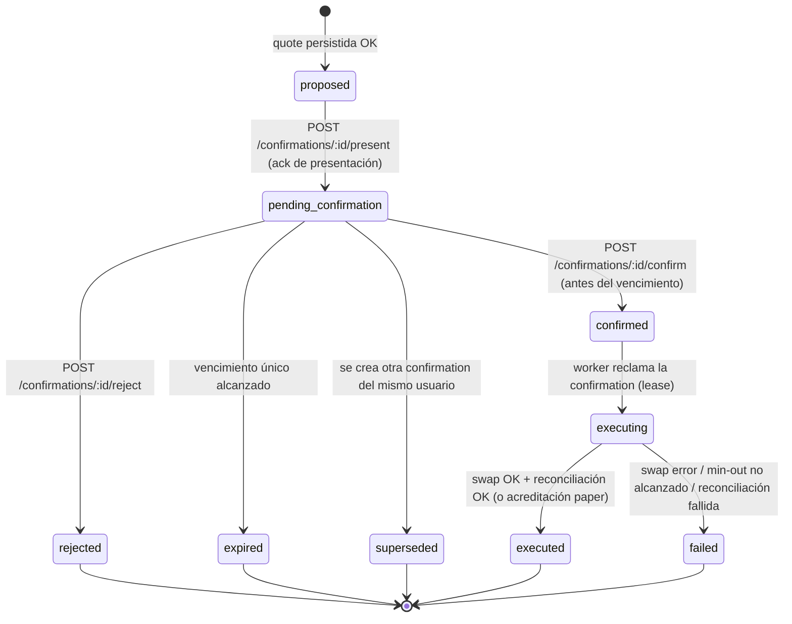

# 04 — Confirmation gate

## Objetivo

Especificar la validación que separa una intención de un movimiento de fondos: estados, TTL, idempotency, copy exacto y audit log. Es la pieza de seguridad central del producto.

## Alcance

- Máquina de estados de una confirmation y sus transiciones válidas.
- Dónde vive el gate (con alternativas) y cómo lo presenta el frontend.
- Copy UX en español rioplatense y campos del audit log.

## Fuera de alcance

- Autenticación del usuario que confirma como sistema completo (ver [05-backend-api.md](05-backend-api.md)): el gate **exige** el chequeo de ownership que [05-backend-api.md](05-backend-api.md) especifica; no asume ninguna identidad sin ese chequeo.
- Confirmaciones para operaciones que no mueven fondos (consultas no pasan por el gate).

## Detalle

### Regla canónica de límites

**Los límites nunca saltean el gate; solo agregan fricción sobre umbrales.** Ningún spending limit, tope o saldo convierte una propuesta en auto-aprobada, en ninguna fase. Por encima de un umbral puede exigirse más fricción (re-autenticación, confirmación reforzada); por debajo, el gate se aplica igual. Esta es la única lectura válida de cualquier límite mencionado en este paquete ([01-wallet.md](01-wallet.md), [06-roadmap-risks.md](06-roadmap-risks.md)).

### Dónde vive el gate

| Ubicación | Cómo funciona | Problema |
|---|---|---|
| Entre el usuario y el backend (el frontend "frena" al agente) | El chat muestra la propuesta y solo reenvía si el usuario confirma | El backend confía en el cliente: un cliente modificado, un bug o el propio LLM vía otro canal ejecuta sin validar. La seguridad queda en la capa más débil. |
| **Dentro del backend (recomendado)** | El backend crea la confirmation en estado `pending_confirmation` y **no existe endpoint de ejecución sin una confirmation `confirmed` vigente**. El frontend solo presenta y captura la decisión. | Ninguno estructural; exige modelar estados e idempotency (este documento). |

**Decisión: gate dentro del backend.** El agente propone, el backend dispone, el frontend presenta. Esto sigue la línea ya inclinada por el titular del proyecto y es la única opción donde la garantía no depende de que el cliente se comporte.

### Máquina de estados

Reglas:

- **Presentación explícita:** la transición `proposed --> pending_confirmation` la dispara `POST /confirmations/:id/present`, que llama el frontend cuando la tarjeta se renderiza (ack de presentación). Ese endpoint fija `presentedAt` con la hora del servidor y recién ahí empieza a correr el vencimiento. Sin presentación no hay countdown ficticio: una confirmation nunca vence antes de ser vista.
- **Vencimiento único y visible:** la ventana para decidir es `min(TTL del gate, vencimiento de la quote)` — TTL del gate de 60 s desde `presentedAt` y quote de 30 s — y la tarjeta muestra **esa** cuenta regresiva en vivo, no dos relojes. Vencida, confirmar devuelve `409 confirmation_expired` y el agente re-cotiza solo si el usuario lo pide, creando una confirmation **nueva**.
- **Refresh nunca reutiliza una confirmation:** cualquier refresh, re-quote o reintento de propuesta crea una confirmation nueva contra una quote nueva. No existe "refrescar la misma tarjeta" ([06-roadmap-risks.md](06-roadmap-risks.md), Q2).
- **Idempotency en la decisión:** `POST /confirm` sobre una confirmation ya `confirmed`/`executing`/`executed` devuelve el estado actual sin re-ejecutar (idempotency key = `confirmationId`). Doble click, retry de red o F5 nunca duplican un swap.
- **Estado `executing` con lease/claim:** al pasar a `executing`, el worker reclama la confirmation con un lease con vencimiento (claim atómico en DB: solo un worker obtiene la transición `confirmed --> executing`). Un lease vencido sin resultado no re-ejecuta a ciegas: primero reconcilia (abajo).
- **Idempotencia downstream (una ejecución por confirmation, enforceada):** antes de enviar cualquier transacción, el backend persiste la referencia del proveedor: el `requestId`/identificador de la quote de Jupiter y la signature intent asociada al order. En un retry o tras un crash, el worker primero busca esa referencia (lookup de signature/estado del order) y solo re-envía si prueba que nunca se envió. Sin esa prueba, la confirmation pasa a `failed` con motivo visible antes que arriesgar un segundo envío. En Track A, la "referencia" es el registro de simulación de la quote.
- **Una pendiente por usuario, con linearización:** existe un constraint único parcial en DB — un solo `userId` con estado en (`proposed`, `pending_confirmation`) a la vez ([05-backend-api.md](05-backend-api.md)). Crear una nueva confirmation marca la anterior como `superseded` (no `expired`: son causas distintas) en la misma transacción que crea la nueva, de modo que no hay ventana en la que un confirm tardío sobre la vieja ejecute. El usuario que intenta decidir la vieja recibe el error tipado **`409 CONFIRMATION_SUPERSEDED`** y la UI deshabilita la tarjeta vieja en cuanto renderiza la nueva.
- **La ejecución es interna:** ningún endpoint público ejecuta swaps; solo el worker del backend consume confirmations `confirmed` vía la transición con lease. Exactamente una ejecución por confirmation.
- **Finalidad:** "compraste" y "no se ejecutó nada" se afirman solo con la transacción en estado **`finalized`** (o, en Track A, con el monto simulado a quote acreditado en el ledger paper). Estados intermedios (`processed`/`confirmed` de Solana) se muestran como "procesando", nunca como éxito ni como fracaso.
- **Rechazo y expiración no dejan residuos:** sin holds de fondos; el saldo no se reserva.

### Copy UX (es-AR, exacto)

Los ejemplos usan el saldo paper de referencia de 100 USDC y una compra de 10 USD, consistentes en todo el paquete ([00-overview.md](00-overview.md), [01-wallet.md](01-wallet.md)).

Propuesta (tarjeta sobre el chat; la cuenta regresiva es el vencimiento único en vivo):

> **¿Confirmás esta compra?**
> Estás comprando **10 USD** de **S&P 500 (SPYx)**.
> Cotización: recibís ≈ 0,01385 SPYx (mínimo 0,01378 SPYx). Slippage: 50 bps. Impacto en el precio: 0,04%.
> Saldo después de la compra: ≈ 90 USD en USDC.
> La cotización vence en 0:30.
> [Confirmar] [Rechazar]

Confirmada y ejecutada (modo real, tras finalidad `finalized` y reconciliación OK):

> Listo. Compraste ≈ 0,01385 SPYx por 10 USD. [Ver transacción](https://solscan.io/tx/<signature>)

Confirmada y acreditada (Track A paper; sin link a explorer, jamás):

> Listo. Simulado a quote: se acreditaron ≈ 0,01385 SPYx por 10 USD en tu saldo paper. Esto no ejecutó ninguna transacción real.

Rechazada:

> Compra cancelada. No se movió nada de tu wallet.

Expirada:

> La cotización venció y la compra no se hizo. ¿Querés que te cotice de nuevo?

Superseded (el usuario intenta decidir una tarjeta vieja):

> Esta propuesta ya no está vigente porque hay una más nueva. Fijate en la última tarjeta.

Error de ejecución — sin débito (la transacción no llegó a enviarse o el envío falló antes de entrar a la red):

> La compra no se pudo ejecutar (<motivo en lenguaje llano>). No se debitó nada de tu wallet. Quedó registrada como #<confirmationId>.

Error de ejecución — con débito revertido (hubo envío y la cadena lo revirtió, o la reconciliación detectó `actualOutAtomic < minOutAtomic` tras la finalidad):

> La compra no se pudo completar (<motivo en lenguaje llano>). El débito se revirtió y tu saldo quedó como estaba. Quedó registrada como #<confirmationId>.

El backend elige una de las dos copias de error según el estado real registrado (sin débito si no hay signature enviada; con débito revertido si la hay y la reconciliación así lo prueba). No existe copy con either/or sin resolver. El monto se repite en números y el activo con nombre humano **y** símbolo (SPYx), porque el error típico no es técnico: es el usuario confirmando otra cosa de la que creía.

### Audit log

Cada confirmation persiste (nunca se borra): `confirmationId`, `userId`, `walletAddress`, `mode` (`paper` | `real`), `inputMint`, `outputMint`, `amountInAtomic`, `quotedOutAtomic`, `minOutAtomic`, `slippageBps`, `priceImpactPct`, `quoteId`, `status` + timestamps de cada transición (`createdAt`, `presentedAt`, `decidedAt`, `executedAt`), `decidedBy` (**el `userId` autenticado que decidió**, nunca un canal), `txSignature` (nullable; **obligatoria si `mode = real`** y la ejecución llegó a envío, [05-backend-api.md](05-backend-api.md)), `errorCode` (nullable), `rawIntent` (texto original del usuario) y `llmSummary` (interpretación del agente). Con esto se reconstruye cualquier operación sin mirar logs del servidor.

Integridad y privacidad del audit log:

- **Append-only con hash chain:** cada registro incluye `prevHash` y el hash del registro propio calculado sobre el anterior; alterar o borrar un registro rompe la cadena y es detectable. Ningún proceso actualiza ni borra filas del audit log.
- **Retención y redacción:** `rawIntent` se guarda completo solo en el audit (acceso de operador) y se muestra redactado en cualquier superficie de display (sin datos personales que el usuario haya pegado por error). La retención es indefinida en la demo; en fase 2 se define una política de retención por usuario y volumen (el store crece una fila por intención financiera) antes de abrir registro público.

## Criterios de aceptación

- [ ] Es imposible ejecutar un swap con una confirmation en `proposed`, `rejected`, `expired` o `superseded` (test de integración por estado).
- [ ] Confirmar dos veces la misma confirmation produce una sola transacción on-chain; un crash entre envío y registro se resuelve por reconciliación de signature antes de cualquier reintento (test).
- [ ] La tarjeta muestra una sola cuenta regresiva igual a `min(TTL, quote)` y confirmar tras ese vencimiento devuelve 409 y no ejecuta.
- [ ] Crear una segunda confirmation deja la primera en `superseded`, su tarjeta deshabilitada y su confirm/reject respondiendo `409 CONFIRMATION_SUPERSEDED` (test).
- [ ] Ningún refresh reutiliza una confirmation: todo refresh genera quote y confirmation nuevas (test).
- [ ] Cada cambio de estado aparece en el audit log con timestamp y `decidedBy` = `userId` autenticado, con la hash chain verificable.
- [ ] El copy de la tarjeta y de los dos errores coincide literalmente con esta spec (salvo variables).

## Preguntas abiertas

- ¿TTL de 60 s alcanza para una demo en vivo con explicación oral? Recomendación registrada en [06-roadmap-risks.md](06-roadmap-risks.md), Q2: TTL 60 s por defecto; la explicación oral ocurre antes de presentar la tarjeta, no estirando su vida.
