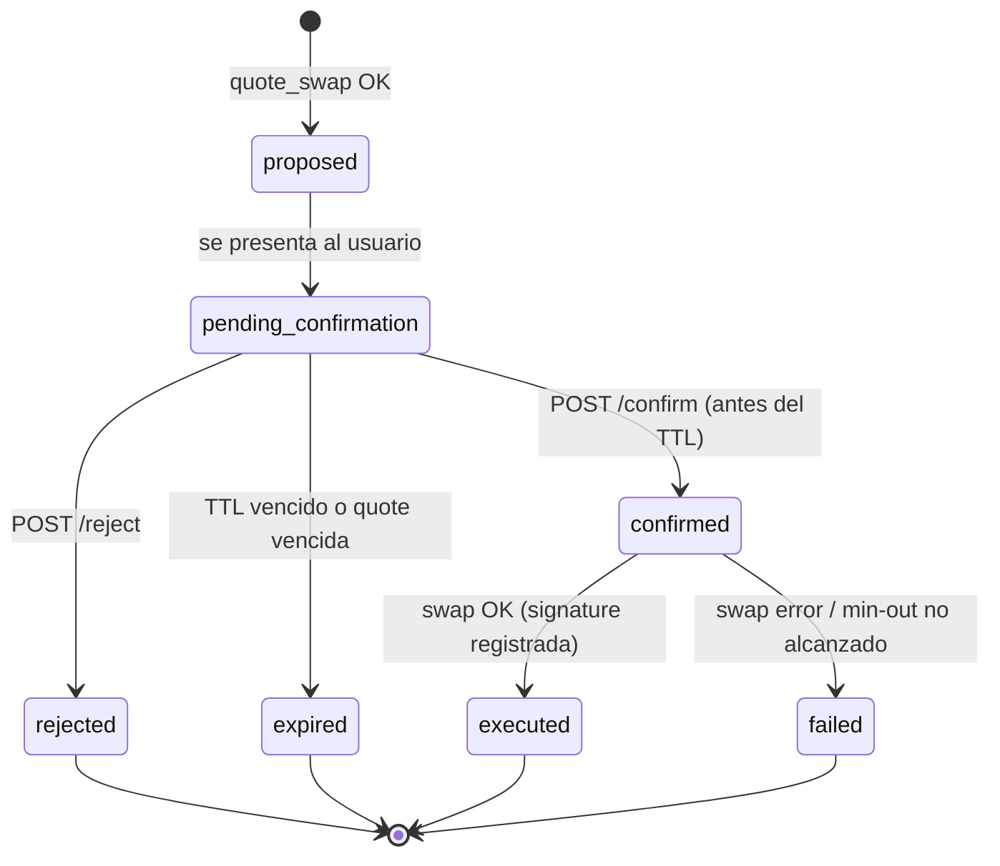

# 04 — Confirmation gate

## Objetivo

Especificar la validación que separa una intención de un movimiento de fondos: estados, TTL, idempotency, copy exacto y audit log. Es la pieza de seguridad central del producto.

## Alcance

- Máquina de estados de una confirmation y sus transiciones válidas.
- Dónde vive el gate (con alternativas) y cómo lo presenta el frontend.
- Copy UX en español rioplatense y campos del audit log.

## Fuera de alcance

- Autenticación del usuario que confirma (ver [05-backend-api.md](05-backend-api.md)): el gate asume identidad ya resuelta.
- Confirmaciones para operaciones que no mueven fondos (consultas no pasan por el gate).
- Límites de gasto que auto-aprueban (eso es política de fase 2 con Phantom Connect, no reemplaza al gate en la demo).

## Detalle

### Dónde vive el gate

| Ubicación | Cómo funciona | Problema |
|---|---|---|
| Entre el usuario y el backend (el frontend "frena" al agente) | El chat muestra la propuesta y solo reenvía si el usuario confirma | El backend confía en el cliente: un cliente modificado, un bug o el propio LLM vía otro canal ejecuta sin validar. La seguridad queda en la capa más débil. |
| **Dentro del backend (recomendado)** | El backend crea la confirmation en estado `pending_confirmation` y **no existe endpoint de ejecución sin una confirmation `confirmed` vigente**. El frontend solo presenta y captura la decisión. | Ninguno estructural; exige modelar estados e idempotency (este documento). |

**Decisión: gate dentro del backend.** El agente propone, el backend dispone, el frontend presenta. Esto sigue la línea que Dino ya inclinaba y es la única opción donde la garantía no depende de que el cliente se comporte.

### Máquina de estados

Reglas:

- **TTL: 60 segundos** desde `pending_confirmation` (configurable; la quote de [02-swaps-xstocks.md](02-swaps-xstocks.md) vence a los 30 s, lo que llegue primero manda). Vencida, confirmar devuelve `409 confirmation_expired` y el agente re-cotiza si el usuario quiere.
- **Idempotency:** `POST /confirm` sobre una confirmation ya `confirmed`/`executed` devuelve el estado actual sin re-ejecutar (idempotency key = `confirmationId`). Doble click, retry de red o F5 nunca duplican un swap.
- **Una pendiente por usuario:** crear una nueva confirmation invalida (`expired`) la pendiente anterior del mismo usuario. Nada de colas de propuestas.
- **La ejecución es interna:** ningún endpoint público ejecuta swaps; solo el worker del backend consume confirmations `confirmed`. Exactamente una ejecución por confirmation, garantizada por transición atómica de estado en DB.
- **Rechazo y expiración no dejan residuos:** sin holds de fondos; el saldo no se reserva.

### Copy UX (es-AR, exacto)

Propuesta (tarjeta sobre el chat):

> **¿Confirmás esta compra?**
> Estás comprando **100 USD** de **S&P 500 (SPYx)**.
> Cotización: recibís ≈ 0,1385 SPYx (mínimo 0,1378 SPYx). Impacto en el precio: 0,04%.
> Saldo después de la compra: ≈ 2 USD en USDC. *(en la demo, montos según fondeo real)*
> La cotización vence en 0:45.
> [Confirmar] [Rechazar]

Confirmada y ejecutada:

> Listo. Compraste ≈ 0,1385 SPYx por 100 USD. [Ver transacción](https://solscan.io/tx/<signature>)

Rechazada:

> Compra cancelada. No se movió nada de tu wallet.

Expirada:

> La cotización venció y la compra no se hizo. ¿Querés que te cotice de nuevo?

Error de ejecución:

> La compra no se pudo ejecutar (<motivo en lenguaje llano>). No se debitó nada / se debitó y revertió según corresponda. Quedó registrada como #<confirmationId>.

El monto se repite en números y el activo con nombre humano **y** símbolo (SPYx), porque el error típico no es técnico: es el usuario confirmando otra cosa de la que creía.

### Audit log

Cada confirmation persiste (nunca se borra): `confirmationId`, `userId`, `walletAddress`, `inputMint`, `outputMint`, `amountInAtomic`, `quotedOutAtomic`, `minOutAtomic`, `slippageBps`, `priceImpactPct`, `quoteId`, `status` + timestamps de cada transición (`createdAt`, `presentedAt`, `decidedAt`, `executedAt`), `decidedBy` (canal: web/demo operator), `txSignature` (nullable), `errorCode` (nullable), `rawIntent` (texto original del usuario) y `llmSummary` (interpretación del agente). Con esto se reconstruye cualquier operación sin mirar logs del servidor.

## Criterios de aceptación

- [ ] Es imposible ejecutar un swap con una confirmation en `proposed`, `rejected` o `expired` (test de integración por estado).
- [ ] Confirmar dos veces la misma confirmation produce una sola transacción on-chain.
- [ ] Una confirmation confirmada tras el TTL devuelve 409 y no ejecuta.
- [ ] Cada cambio de estado aparece en el audit log con timestamp y actor.
- [ ] El copy de la tarjeta coincide literalmente con esta spec (salvo variables).

## Preguntas abiertas

- ¿TTL de 60 s alcanza para una demo en vivo con explicación oral? Recomendación: 120 s en modo demo, configurable por env. → [06-roadmap-risks.md](06-roadmap-risks.md), Q2.
