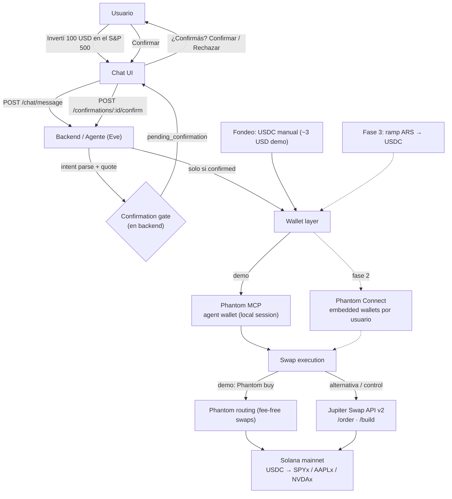

# Agente inversor por lenguaje natural — Specs

## Visión en una página

Un usuario escribe **"Invertí 100 USD en el S&P 500"** y el agente ejecuta la compra, pero nadie mueve plata sin una confirmación explícita. El backend interpreta la intención, resuelve el activo (S&P 500 → SPYx), cotiza el swap USDC → xStock, y le muestra al usuario: *"Estás comprando 100 USD de S&P 500 (SPYx). ¿Confirmás?"* Recién con **Confirmar** se firma y se envía la transacción on-chain en Solana. Rechazar o dejar vencer la propuesta no mueve un centavo.

La demo prueba una sola tesis: un LLM puede operar una wallet real de forma útil si el sistema — no el modelo — controla el dinero. Por eso el confirmation gate vive en el backend, es idempotente, tiene TTL y deja audit log; el agente propone, el backend dispone.

## Índice

| Doc | Contenido |
|---|---|
| [00-overview.md](00-overview.md) | Problema, usuarios, objetivo de la demo, non-goals y supuestos |
| [01-wallet.md](01-wallet.md) | Modelo de wallet: Phantom MCP (demo) vs Phantom Connect (multi-usuario), custodia |
| [02-swaps-xstocks.md](02-swaps-xstocks.md) | Ejecución de swaps: Phantom `buy` vs Jupiter Swap API v2, token registry, slippage |
| [03-agent-flows.md](03-agent-flows.md) | Comportamiento del agente (Eve): intent parsing, alias map, contrato de tools |
| [04-confirmation-gate.md](04-confirmation-gate.md) | El gate de validación: estados, TTL, idempotency, copy UX, audit log |
| [05-backend-api.md](05-backend-api.md) | Contrato HTTP, modelo de datos y auth |
| [06-roadmap-risks.md](06-roadmap-risks.md) | Fases 0–3, riesgos y preguntas abiertas para Dino |

## Alcance

**MVP — demo (este paquete):** un solo usuario-operador, una agent wallet de Phantom MCP fondeada con ~3 USD en USDC, compra USDC → SPYx/AAPLx/NVDAx por chat con confirmation gate, historial de transacciones y portfolio leído de la wallet. Sin ramp, sin multi-tenancy, sin venta en el flujo feliz (queda especificada solo como extensión).

**Fase 2+ (fuera de este paquete, ver [06-roadmap-risks.md](06-roadmap-risks.md)):** muchos usuarios, cada uno con su embedded wallet de Phantom Connect creada al registrarse, spending limits por usuario, y en fase 3 fondeo en pesos (ARS → USDC vía ramp de terceros hacia la wallet del usuario).

## Arquitectura

## Decisiones ya tomadas

1. **Gate dentro del backend**, presentado por el frontend (alternativas analizadas en [04-confirmation-gate.md](04-confirmation-gate.md)).
2. **Phantom MCP para la demo, Phantom Connect para escalar.** El MCP corre con session local y una sola agent wallet; no es multi-tenant ([01-wallet.md](01-wallet.md)).
3. **Phantom `buy` como ejecutor primario de la demo; Jupiter Swap API v2 como path de control/fallback** con quote propio y firma explícita ([02-swaps-xstocks.md](02-swaps-xstocks.md)).
4. **Eve (vercel/eve) como agent framework**, estructura filesystem-first en `agent/` ([03-agent-flows.md](03-agent-flows.md)).

## Fuentes (hechos verificados por el Captain, 2026-11-27)

- Phantom MCP server (`@phantom/mcp-server`): agent wallet dedicada y aislada, 30 tools, sign-in por device-code, signing vía OIDC stamper → KMS con policy enforcement.
- Phantom Connect: embedded wallets con social login, spending limit default de USD 1.000/app/día por usuario, sesiones ~31 días, non-custodial.
- Jupiter Swap API v2 (`https://api.jup.ag/swap/v2`): `/order` devuelve quote ruteada + transacción lista para firmar; `/build` devuelve instructions. Los xStocks operan como tokens SPL.
- Eve (vercel/eve): framework de agentes durable, filesystem-first; requiere Node 24+ y pnpm.
- Los mint addresses de [02-swaps-xstocks.md](02-swaps-xstocks.md) se verificaron contra la token API de Jupiter el 2026-11-26; aun así, re-verificar antes de operar (ver TODOs).
